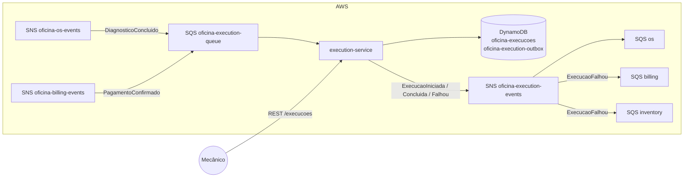
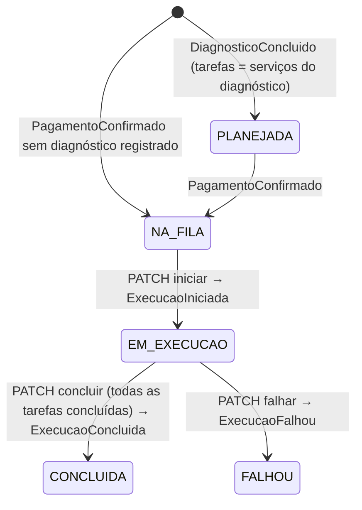

# Oficina Execution Service

Microsserviço de **Execução e Produção** da oficina mecânica (Tech Challenge 15SOAT, Fase 4).
Gerencia a fila de execução das ordens de serviço, o andamento do diagnóstico e do reparo de
cada serviço e comunica o início, a conclusão ou a falha da execução ao OS Service.

Faz parte da Saga coreografada descrita na
[ADR 005](https://github.com/GrupoPosTech-FIAP/oficina-app-api/blob/main/docs/adr/005-saga-coreografada.md).

## Stack

Java 25 · Spring Boot 4.1 · **Amazon DynamoDB** (AWS SDK v2) · SNS/SQS · Spring Security + JWT ·
OpenAPI/Swagger · JaCoCo · Testcontainers (DynamoDB Local) · Docker / Kubernetes (Kustomize).

## Arquitetura

Clean Architecture em um único módulo, com as dependências apontando para dentro:

```
adapters (web, messaging, persistence, security, config)
   └─► application (casos de uso, portas: ExecucaoGateway)
          └─► domain (Execucao, Tarefa, Andamento — sem dependência de framework)
```



### Ciclo de vida



Durante `EM_EXECUCAO` o mecânico inicia e conclui cada tarefa e registra andamentos por etapa
(`DIAGNOSTICO`, `REPARO`, `TESTE`).

### Eventos

| Direção | Evento | Efeito |
|---|---|---|
| Consome | `DiagnosticoConcluido` (os) | Cria a execução `PLANEJADA` com uma tarefa por serviço |
| Consome | `PagamentoConfirmado` (billing) | Coloca a execução `NA_FILA` |
| Publica | `ExecucaoIniciada` | OS → `EM_EXECUCAO` |
| Publica | `ExecucaoConcluida` | OS → `FINALIZADA` |
| Publica | `ExecucaoFalhou` | Compensação: inventory estorna os insumos, billing reembolsa no Mercado Pago, OS → `CANCELADA` |

Os payloads seguem o catálogo da ADR 005 (`ordemServicoId`, `iniciadaEm`, `concluidaEm`, `motivo`).

## Por que DynamoDB

O Tech Challenge exige ao menos um banco NoSQL; os outros serviços usam PostgreSQL. A execução se
encaixa bem num banco de documentos:

- **Acesso por chave:** toda operação lê e grava a execução de uma OS (`ordemServicoId`). A fila é
  uma consulta no índice `status-ordenacao` (status + data de chegada).
- **Agregado inteiro num item:** tarefas e andamentos ficam dentro do próprio item, sem joins.
- **Gerenciado e barato no Learner Lab:** `PAY_PER_REQUEST`, sem instância para subir, e a `LabRole`
  já tem acesso (o `oficina-auth-gateway` usa DynamoDB no rate limit).

### Consistência sem transação relacional

| Garantia | Como |
|---|---|
| Transactional Outbox | `TransactWriteItems` grava a execução e os eventos na tabela `oficina-execution-outbox` numa única transação. O `OutboxRelay` publica os pendentes (índice esparso `pendentes`) no SNS |
| Concorrência | Controle otimista: cada gravação exige `versao` igual à lida (`attribute_not_exists` na criação). Conflito vira `409` na API ou nova tentativa da fila |
| Idempotência | Os dois eventos consumidos só criam ou avançam a execução; evento repetido encontra a execução adiante e é ignorado. Não há tabela `eventos_processados` |

## API

Todas as rotas exigem `Authorization: Bearer <jwt>` (mesmo segredo do `oficina-app-api`).
Documentação interativa em `/swagger-ui.html`.

| Método | Rota | Descrição |
|---|---|---|
| GET | `/execucoes?status=NA_FILA` | Fila de execução (mais antigas primeiro) |
| GET | `/execucoes/{ordemServicoId}` | Execução da OS, com tarefas e andamentos |
| PATCH | `/execucoes/{id}/iniciar` | `NA_FILA` → `EM_EXECUCAO` |
| PATCH | `/execucoes/{id}/tarefas/{servicoId}/iniciar` | Tarefa → `EM_ANDAMENTO` |
| PATCH | `/execucoes/{id}/tarefas/{servicoId}/concluir` | Tarefa → `CONCLUIDA` |
| POST | `/execucoes/{id}/andamentos` | `{ "etapa": "REPARO", "descricao": "..." }` |
| PATCH | `/execucoes/{id}/concluir` | `EM_EXECUCAO` → `CONCLUIDA` |
| PATCH | `/execucoes/{id}/falhar` | `{ "motivo": "..." }` → `FALHOU` |
| GET | `/execucoes/servicos/{servicoId}/tempo-medio` | Tempo médio (minutos) do serviço nas execuções concluídas. Substitui o `GET /servicos/{id}/tempo-medio` da app-api |

Erros: `404` OS ou tarefa inexistente, `409` transição inválida ou gravação concorrente, `400` validação.

## Como rodar

```bash
make start        # LocalStack (DynamoDB, SNS, SQS) + aplicação em http://localhost:8084
```

O LocalStack cria tópicos e filas (`localstack/init-mensageria.sh`) e a aplicação cria as tabelas na
subida (`DYNAMODB_CRIAR_TABELAS=true`).

| Variável | Padrão | Descrição |
|---|---|---|
| `DYNAMODB_TABELA_EXECUCOES` | `oficina-execucoes` | Tabela das execuções |
| `DYNAMODB_TABELA_OUTBOX` | `oficina-execution-outbox` | Outbox de eventos |
| `DYNAMODB_ENDPOINT` | — | Endpoint alternativo (LocalStack) |
| `DYNAMODB_CRIAR_TABELAS` | `false` | Cria as tabelas na subida (só local) |
| `MENSAGERIA_HABILITADA` | `false` | Liga relay e consumidor |
| `MENSAGERIA_TOPICO_ARN` / `MENSAGERIA_FILA_URL` | — | `oficina-execution-events` / `oficina-execution-queue` |
| `JWT_SECRET` | segredo de dev | Mesmo do `oficina-app-api` |

## Testes e cobertura

```bash
./mvnw clean verify   # precisa do Docker: os testes de integração sobem o DynamoDB Local
```

- Unitários do domínio e dos casos de uso.
- Integração com DynamoDB Local (Testcontainers): gateway, transação com outbox, conflito de versão
  e ordem da fila.
- Fluxo completo pela API e pelos eventos (`FluxoExecucaoIntegracaoTest`): caminho feliz, falha com
  `ExecucaoFalhou`, eventos repetidos e erros.

O JaCoCo exige **80% de linhas** no `verify` (CI). Relatório em `target/site/jacoco/index.html`.
Cobertura atual: **99,7%** de linhas (47 testes).

[](https://sonarcloud.io/summary/overall?id=GrupoPosTech-FIAP_oficina-execution-service) [](https://sonarcloud.io/component_measures?id=GrupoPosTech-FIAP_oficina-execution-service&metric=coverage)

O CI também analisa o código no
[SonarCloud](https://sonarcloud.io/summary/overall?id=GrupoPosTech-FIAP_oficina-execution-service) e falha se
o quality gate reprovar (roda quando o secret `SONAR_TOKEN` existe na organização).

## Deploy

Ordem: `oficina-infra-cluster` (ECR, tópicos e filas) → `oficina-infra-database` (tabelas DynamoDB)
→ este serviço. O workflow [`deploy.yml`](.github/workflows/deploy.yml) roda manualmente ou numa tag
`v*`: confere as tabelas, publica a imagem no ECR, resolve ARN/URL da mensageria pelo nome e aplica
`k8s/overlays/aws` no EKS. Secrets do repositório: `AWS_ACCESS_KEY_ID`, `AWS_SECRET_ACCESS_KEY`,
`AWS_SESSION_TOKEN` e `JWT_SECRET`.
